

##  Week  

Today: `r TODAY_TOPIC`

. . . 

::: {.small}

- Communicating Results (`quarto`)  ✅
- `R` Basics  ✅
- Data Manipulation in `R`  ✅
- Data Visualization in `R`  ⬅️
  - Static Plots  ⬅️
  - Interactivity, Maps, Animated Plots
- Getting Data into `R`
- Statistical Modeling in `R`

:::


##  Week  

Today: `r TODAY_TOPIC`

::: {.small}
- MP#01 Peer Feedback
- Mid-Semester Check-In Advice
- Warm-Up Exercises
- Plotting: Principles for Visual Storytelling
- Introduction to `ggplot2`
- Plotting FAQs
- Wrap-Up

:::


## MP#01 - Peer Feedback

Assigned *via* GitHub - due on [`r get_mp_pf_deadline(1)`]{color="red"}

- $\approx 4$ feedbacks each 
- Take this seriously: 20\% of this assignment is "meta-review"
- Goal: _rigorous_ _constructive_ critique

Use [helper function](https://michael-weylandt.com/STA9750/tips.html) 
to perform peer feedback assigned to you. Ask on Teams if still having
trouble.

## MP#01 - Peer Feedback

Submissions may not map perfectly to rubric - use your best judgement

. . . 

Be _generous_ but serious: 

::: {.small}

- Goal is improvement, so "everything is great, no comments" is unhelpful
  - Nothing is completely right nor completely wrong
- Remember, *meta-review* (instructor scores of your feedback) to follow

:::

. . .

Learn from this! What can _you_ adapt for MP#02? 

## MP#01 - Peer Feedback {.scrollable}

Example of poor feedback: 

::: {.smaller}

```
Comments
Website looks really good, nice and clean!

Written Communication
Excellent and straight to the point.

Project Skeleton
Solid skeleton, well-organized .

Formatting & Display
Nicely formatted and balanced across the website.

Code Quality
Code runs like Forrest Gump in a Slump.

Data Preparation
Very great. 

Extra Credit
Added graphes for even better understanding.
```

:::

- Superficial comments / no sign of actually reading work

Red Flag: Repeated verbatim on several posts

Reminder: Poor feedback $\neq$ poor work.

## MP#01 - Peer Feedback {.scrollable}

Example of medium feedback: 

::: {.smaller}

```
## Comments

Love the visuals for Press Releases.

### Written Communication

A short summary or a description of this project would be great to add.

### Project Skeleton

Code completes all instructor-provided tasks correctly.

### Formatting & Display

Tables have well-formatted column names; caption would be great.

### Code Quality

Code is clear and well written.

### Data Preparation

Automatic (10/10). Out of scope for this mini-project.

### Extra Credit

I found all the Press Releases very interesting. The visuals were a great touch.
```

:::

- Gave actionable suggestions
- Directionally correct, but a bit vague

## MP#01 - Peer Feedback {.scrollable}

Example of great feedback: 

::: {.smaller}

```
### Written Communication

Overall, your writing is clear and easy to follow. I noticed a few small typos, 
but nothing major — using the built-in spell check in RStudio should catch those 
quickly. Everything else looks solid, and I didn’t have any major concerns based
on my review.

### Project Skeleton

All tasks were completed satisfactorily. 

### Formatting & Display

Overall, your tables and figures are well-organized and clear. There is one 
table in the "Data" section with column titles that could be formatted a little
more cleanly for easier reading. I also noticed a few small typos in some of the
table captions, but they should be easy to fix.

### Code Quality

The code quality is generally good, but there are a few minor linter issues. The
comments could be more frequent and clearer in some places. For example, the
comment `#checking dupolicate so that github will not block it` should be 
corrected to "duplicate," and the explanation could be clarified to avoid
confusion–what duplicate are you referring to, and how does it block GitHub? 
It might confuse someone else reading the code.

Also, I would recommend moving all library imports to the top of the script, 
as that is typically considered standard practice.

### Data Preparation

The data preparation looks solid overall. I like how you handle missing files 
and JSON parsing failures–it demonstrates strong defensive programming.

### Extra Credit

Additional two points for using quarto's video support!
```

:::

- Positive tone
- Detailed comments
- Noted issues & gave suggestions on how to fix
- Noted unclear sections for improvement


## MP#01 - Peer Feedback

Lack of prior experience _is not a hinderance_ here: 

- If something is unclear to you, that's a problem!
- Nothing required super-complex code, so anything overly complex probably could
  have been a simpler way (except for some above-and-beyond stuff)
- You don't have to be definitive in comments - impressions and questions are
  just as helpful.

. . . 

Please ask on Teams if you have any questions.

## Check-In Presentations

Next Week: Mid-Semester Check-In Presentations ([Official Description](../project.qmd#mid-semester-check-in-presentations))

I'm looking for: 

::: {.incremental .small}

- Finalized _overarching question_
- Locking in on _specific questions_
- Evaluation of _relevant_ data sources
  - Anticipated data or statistical challenges
- Engagement with _existing literature_
- 6 minutes

:::

. . . 

Mainly, I want to see that you will be able to _succeed_ 


## Data Sources

When using 'found' data, two important questions to ask: 

::: {.incremental}

- **Quality**: Does the data do what it claims to?
  - Exhaustiveness, sampling error, sampling bias, missingness
- **Suitability**: Does the data do what you need it to?
  - Right 'unit of analysis', construct alignment

:::


. . . 

Your goal is not to find _perfect_ data sets; your goal is to understand the
strengths and weaknesses of what you can access and to work with them accordingly. 


## Prior Art

Context and Novelty: _Why_ is your project worth doing and what does it add to the
conversation? 

::: {.incremental}

- What else have people said on your topic? 
  - What is missing? 
- What do you have to add to this conversation? (Novelty)
  - New data set, new way of measuring, new style of analysis
  
:::

. . . 

A _research_ project is not just summarization of other work: 
how can you contribute something new?

. . . 

Possible forms of **Novelty**: 

- New time period (post-COVID)
- Applying an Analysis from LA to NYC
- Using an alternative data source


How does your project _complement_ and _contrast_ work already done on the topic?


## Project Advice

General Advice:

::: {.incremental}

- Work on _as small a scale as possible_
- Leave room to _demonstrate your coding skill_: if you can't  
  demonstrate the skills of this class, your SQ may be too small
- Plan how to _integrate_ your findings: if you find 5 factors 
  are all correlated with response, how can you identify which ones
  are most important? 

:::

. . . 

After presentations: 100% optional intro to SQL




# Review Exercise

## GMT Anomaly

[CDIAC](https://web.archive.org/web/20170901063440/http://cdiac.ornl.gov/) 
estimates of global temperature

- Global Mean Temperature Anomaly (difference from baseline)
- This is the "2°" reference of the [2015 Paris Climate Accords](https://en.wikipedia.org/wiki/Paris_Agreement)

. . . 

`cdiac` data in `CVXR` package or via my GitHub: 

```{r}
#| warning: false
#| message: false
cdiac <- read_csv("https://michael-weylandt.com/STA9750/cdiac.csv")
cdiac
```

## Temperature Anomaly

Mann, Bradley, & Hughes. *Geophysical Research Letters* 26(6). 1999. (*via Wikipedia*)

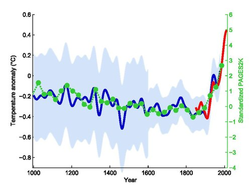{height="500px" fig-align="center"}


## GMT Anomaly {.scrollable}

In breakout rooms: 

1. In what year was the highest annual anomaly observed? The lowest?
2. For how many months was 2015 the highest anomaly recorded? 
3. For how many years did July have the largest anomaly of that year?

See [Lab #06](../labs/lab06.html#review) for details.



## Aside: Oak Ridge

{height="500px" fig-align="center"}

## Calutron Girls

*Via Wikipedia*:

{height="500px" fig-align="center"}

# Plotting

## Why Visualization?

Why do we visualize data? 

::: {.incremental}

- Data exploration and understanding
- Hypothesis generation
- Data communication
- Humans are better at visuals than numbers
- Allow the data to _surprise_ you

:::

## Why Visualization?

::: {.center}

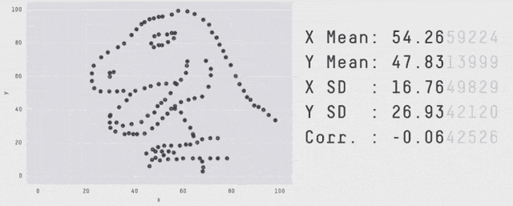{width="80%"}

:::

. . . 

Same $\mu_X, \mu_Y, \sigma_X, \sigma_Y, \rho_{XY}, \beta_{Y|X}, \dots$ - OLS can't distinguish

## Why Visualization?

::: {.center}

{width="80%"}

:::

::: {.smaller}

Modeling and visualizing are not sequential: 

- Build a model, where does it fail?
- See a pattern, does it hold up in a model / test?

:::

## Spot the Problem!


<!-- Crime Growth (Reversed X) --> 

Examples from [Viz.WTF](https://viz.wtf): 

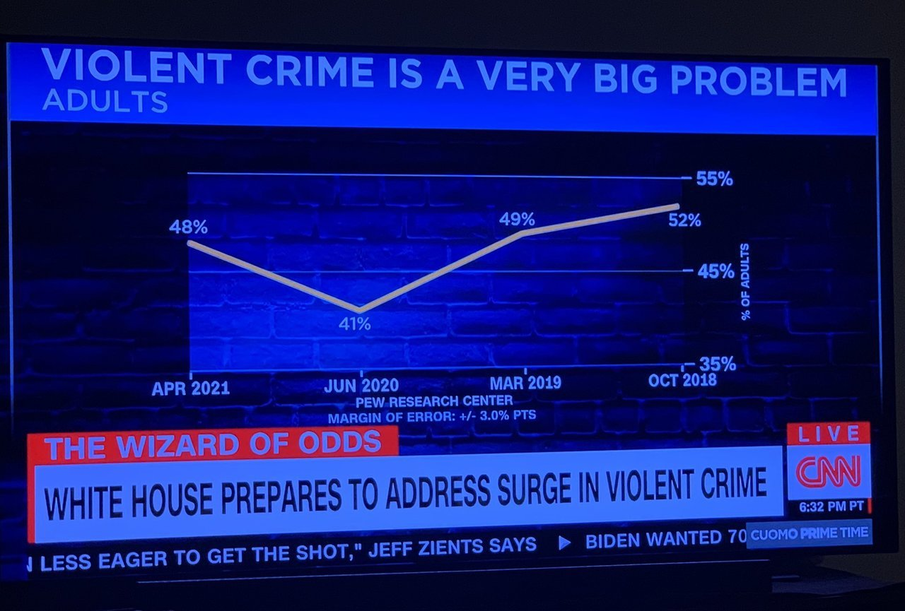{height="550px" fig-align="center"}

## Spot the Problem!


<!-- Insane Color Labels --> 

Examples from [Viz.WTF](https://viz.wtf): 

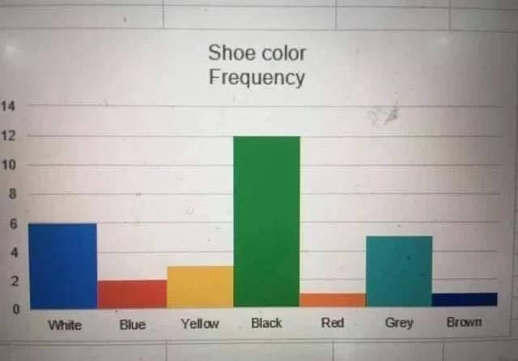{height="550px" fig-align="center"}

## Spot the Problem!

<!-- Color Pie Chart -->

Examples from [Viz.WTF](https://viz.wtf): 

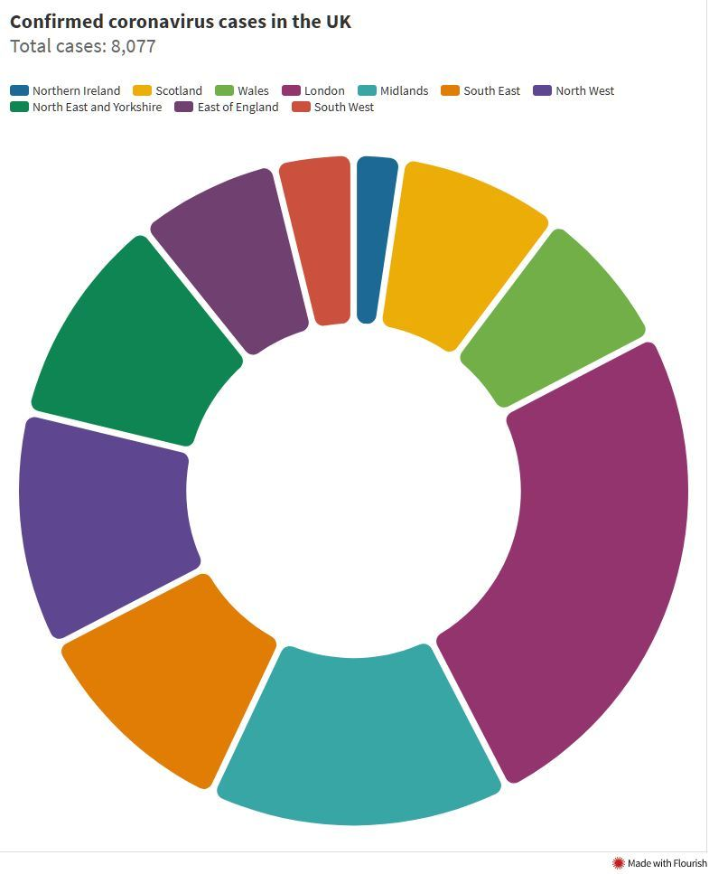{height="550px" fig-align="center"}

## Spot the Problem!

<!-- WFH Unlabeled Pie Chart --> 

Examples from [Viz.WTF](https://viz.wtf): 

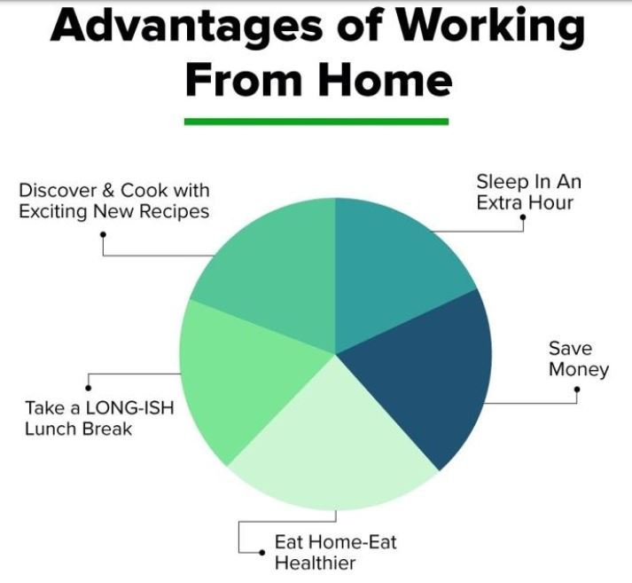{height="550px" fig-align="center"}

## Spot the Problem!

<!-- 3D Pie -->

Examples from [Viz.WTF](https://viz.wtf): 

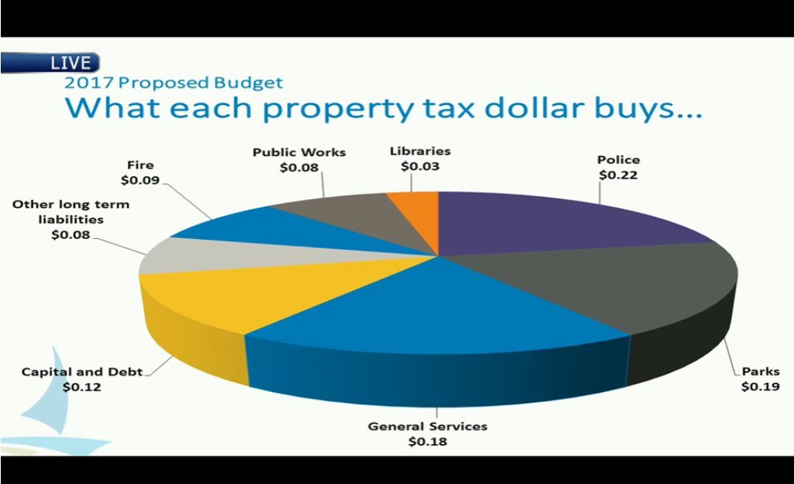{height="550px" fig-align="center"}

## Spot the Problem!

<!-- >100% Pie Chart --> 

Examples from [Viz.WTF](https://viz.wtf): 

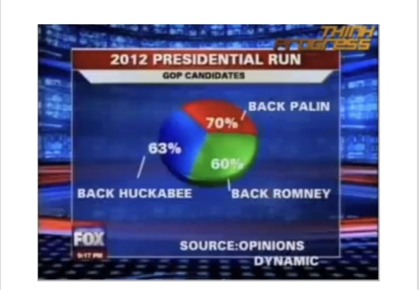{height="550px" fig-align="center"}

## Spot the Problem!

<!-- Non Radial Pie Chart -->

Examples from [Viz.WTF](https://viz.wtf): 

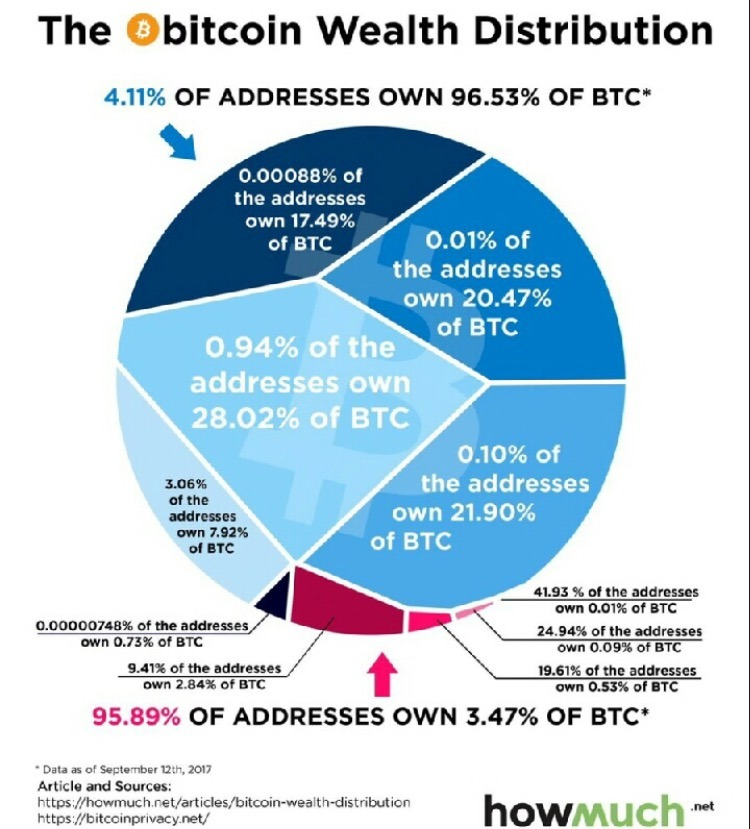{height="550px" fig-align="center"}

## Spot the Problem!

<!-- Compound Pie -->

Examples from [Viz.WTF](https://viz.wtf): 

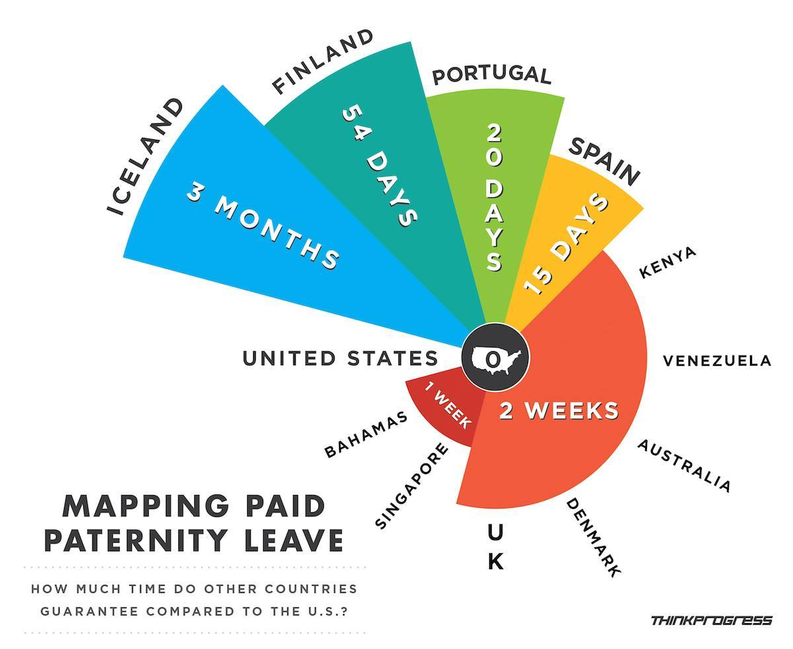{height="550px" fig-align="center"}

## Spot the Problem!

<!-- Polar X Coordinate -->

Examples from [Viz.WTF](https://viz.wtf): 

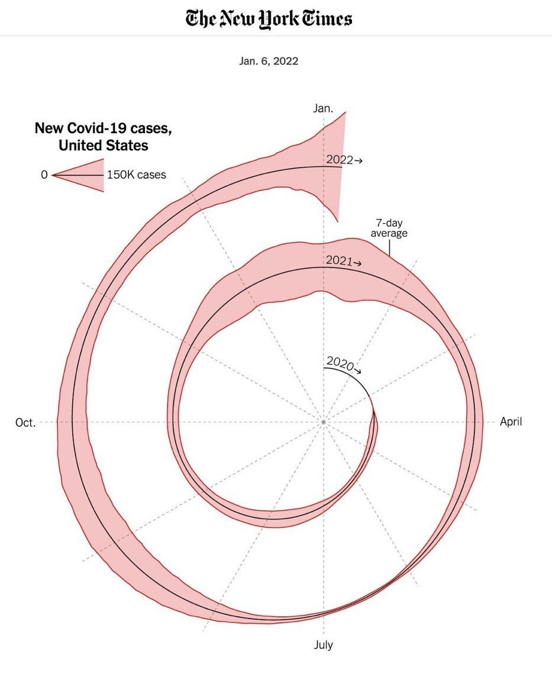{height="550px" fig-align="center"}

## Spot the Problem!

<!-- Vegan Cheese Growth --> 

Examples from [Viz.WTF](https://viz.wtf): 

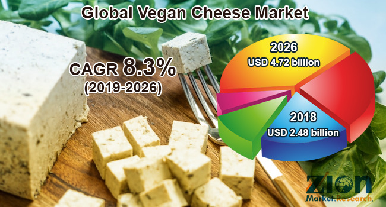{height="550px" fig-align="center"}

## Spot the Problem!

<!-- X vs 1 -X -->

Examples from [Viz.WTF](https://viz.wtf): 

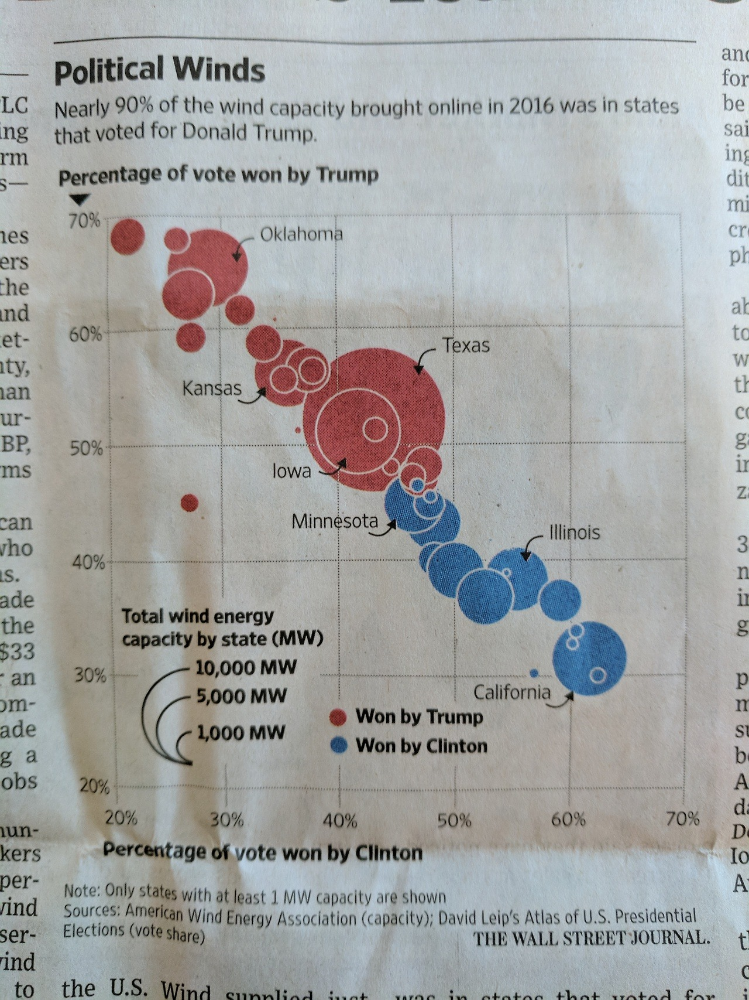{height="550px" fig-align="center"}

## Spot the Problem!

<!-- Double Axis Chart -->

Examples from [Viz.WTF](https://viz.wtf): 

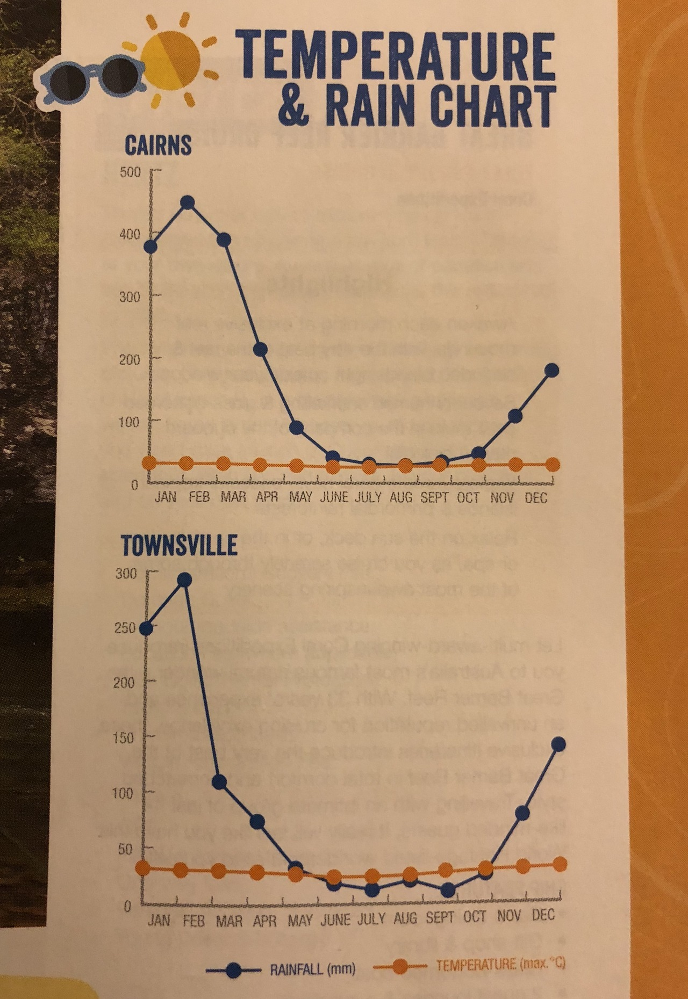{height="550px" fig-align="center"}

## Spot the Problem!

<!-- Map vs Area -->

Examples from [Viz.WTF](https://viz.wtf): 

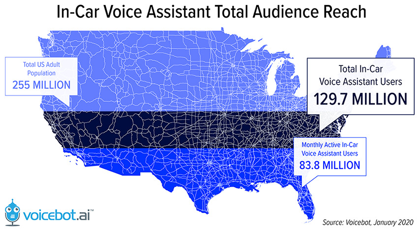{height="550px" fig-align="center"}

## Spot the Problem!

<!-- Biden / Trump Georgia --> 

Examples from [Viz.WTF](https://viz.wtf): 

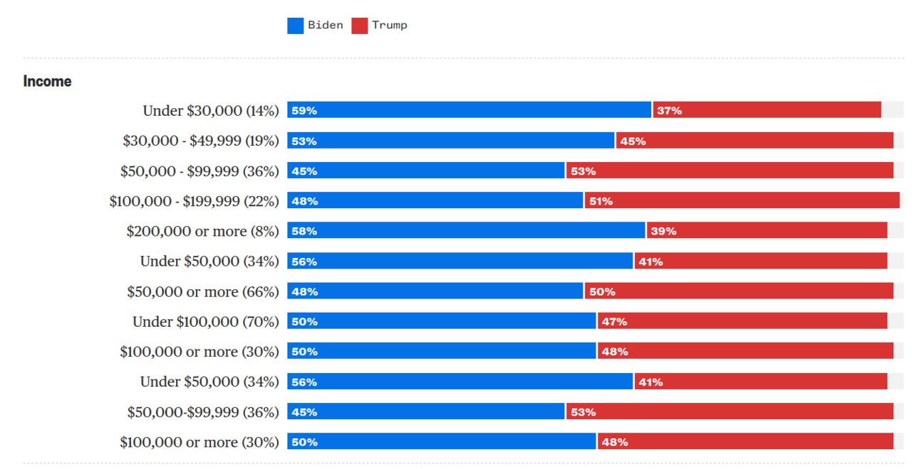{height="550px" fig-align="center"}


## Spot the Problem! 

{height="600px" fig-align="center"}

<blockquote class="twitter-tweet" style="margin: auto;"><p lang="en" dir="ltr">BREAKING🚨: Asteroid the size of 14 flamingos has just skimmed past Earth, according to NASA. <a href="https://t.co/vfUTk2OAvG">pic.twitter.com/vfUTk2OAvG</a></p>&mdash; All day Astronomy (@forallcurious) <a href="https://twitter.com/forallcurious/status/2029627456920105133?ref_src=twsrc%5Etfw">March 5, 2026</a></blockquote> <script async src="https://platform.twitter.com/widgets.js" charset="utf-8"></script>

## Spot the Problem!

From `dadtawrapper.de`:

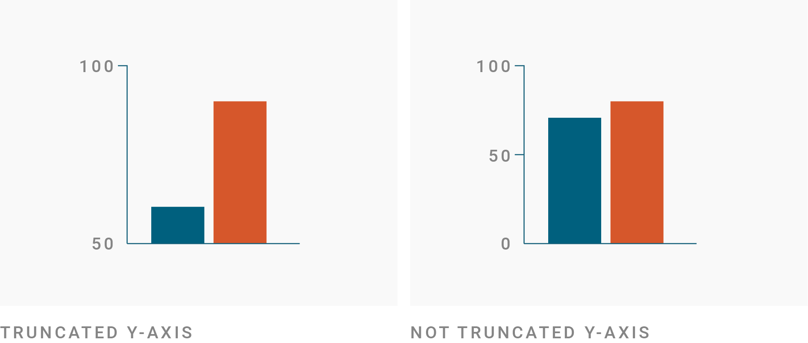

## Zero-Based Axes?

CDIAC Data:

```{r}
#| echo: false
ggplot(cdiac, aes(x=year, y=annual)) + 
  geom_smooth(se=FALSE, color="black") + 
  geom_col(alpha=0.2) + 
  theme_bw() + 
  xlab(NULL) + 
  ylab("Annual Temperature Anomaly [K]")
```

## Zero-Based Axes?

CDIAC Data:

```{r}
#| echo: false
ggplot(cdiac, aes(x=year, y=annual + 14)) + 
  geom_smooth(se=FALSE, color="black") + 
  geom_col(alpha=0.2) + 
  theme_bw() + 
  xlab(NULL) + 
  ylab("Annual Global Mean Temperature [C]")
```

## Zero-Based Axes?

CDIAC Data:

```{r}
#| echo: false
ggplot(cdiac, aes(x=year, y=annual + 14 + 273)) + 
  geom_smooth(se=FALSE, color="black") + 
  geom_col(alpha=0.2) + 
  theme_bw() + 
  xlab(NULL) + 
  ylab("Annual Global Mean Temperature [K]")
```

## Zero-Based Axes?

CDIAC Data:

```{r}
#| echo: false
ggplot(cdiac, aes(x=year, y=annual)) + 
  geom_smooth(se=FALSE, color="black") + 
  geom_col(alpha=0.2) + 
  theme_bw() + 
  xlab(NULL) + 
  ylab("Annual Temperature Anomaly [K]")
```

. . . 

Practical Advice: use the _natural scale_ of the problem

# Plotting with `ggplot2`

## ggplot2

`ggplot2`: 

::: {.incremental}

- **G**rammar of **G**raphics **Plot**ing, Version 2
- Structured Plotting
  - Plotting to express _statistical visualization_
  - Not raw shapes and colors ("graphics primitives")
- Make it easy to make _good_ visualizations
:::

## ggplot2

`ggplot2` provides a system ("grammar") for visualizations:

::: {.incremental}

- `geom_`s: the actual thing to be plotted (points, lines, *etc.*)
- `aes` (aesthetics): mapping of aspects of data 
- `scale_`s: control mapping from 'data space' to 'graphics space'
- `theme`: basic non-data-dependent plot elements
- `guide`s: legends
- `stat_`s: transformations of data used to plot (CDF, histogram counts)

:::

## ggplot2 - Worked Example

Let's plot the `penguins` data. To avoid warnings, use a no-`NA` version:

```{r}
#| message: false
#| eval: false
library(tidyverse)
penguins_ok <- penguins |> drop_na()
ggplot(penguins_ok)
```

. . . 

```{r}
#| message: false
#| echo: false
library(tidyverse)
penguins_ok <- penguins |> drop_na()
ggplot(penguins_ok)
```

## ggplot2 - Worked Example

Need to map specific variables to aspects of plots: `aes` mapping

. . . 

```{r}
#| code-line-numbers: "2"
#| eval: false
ggplot(penguins_ok, 
       aes(x=flipper_len, y=body_mass))
```

:::: {.columns}

::: {.column}

```{r}
#| echo: false
ggplot(penguins_ok, 
       aes(x=flipper_len, y=body_mass))
```

:::

::: {.column}

::::: {.incremental}

- Map `flipper_len` to $x$-axis
- Map `body_mass` to $y$-axis
- Basic labels and ticks auto-generated
- Still nothing in the plot!

::::

:::

::::


## ggplot2 - Worked Example

Add a `geom_` to draw plot elements

. . . 

```{r}
#| code-line-numbers: "3"
#| eval: false
ggplot(penguins_ok, 
       aes(x=flipper_len, y=body_mass)) + 
       geom_point()
```

:::: {.columns}

::: {.column}

```{r}
#| echo: false
ggplot(penguins_ok, 
       aes(x=flipper_len, y=body_mass)) + 
       geom_point()
```

:::

::: {.column}

::::: {.incremental}

- $(x, y)$ coordinates inherited from `aes`
- Default simple points
- Plot elements are **added**
  - Combining elements into a single plot, not sequencing (no `|>`)
::::

:::

::::


## ggplot2 - Worked Example

Replace default labels: 

. . . 

```{r}
#| code-line-numbers: "4-6"
#| eval: false
ggplot(penguins_ok, 
       aes(x=flipper_len, y=body_mass)) + 
       geom_point() + 
       xlab("Flipper Length (mm)") + 
       ylab("Body Mass (g)") + 
       ggtitle("Body Mass vs Flipper Length for 333 Penguins")
```

:::: {.columns}

::: {.column}

```{r}
#| echo: false
#| fig-height: 3
ggplot(penguins_ok, 
       aes(x=flipper_len, y=body_mass)) + 
       geom_point() + 
       xlab("Flipper Length (mm)") + 
       ylab("Body Mass (g)") + 
       ggtitle("Body Mass vs Flipper Length for 333 Penguins")
```

:::

::: {.column}

::::: {.incremental}

- Helper functions `xlab`, `ylab`, `ggtitle`
- Can also use `labs()` directly with named arguments: 
  ```{r}
  #| eval: false
  + labs(x = "Flipper Length(mm)", 
         y = "Body Mass (g)", 
         title="Body Mass vs Flipper Length for 333 Penguins")
  ```
::::

:::

::::


## ggplot2 - Worked Example

Add color `aes`thetic

. . . 

```{r}
#| code-line-numbers: "2"
#| eval: false
ggplot(penguins_ok, 
       aes(x=flipper_len, y=body_mass, color=species)) + 
       geom_point() + 
       xlab("Flipper Length (mm)") + 
       ylab("Body Mass (g)") + 
       ggtitle("Body Mass vs Flipper Length for 333 Penguins")
```

:::: {.columns}

::: {.column}

```{r}
#| echo: false
#| fig-height: 3
ggplot(penguins_ok, 
       aes(x=flipper_len, y=body_mass, color=species)) + 
       geom_point() + 
       xlab("Flipper Length (mm)") + 
       ylab("Body Mass (g)") + 
       ggtitle("Body Mass vs Flipper Length for 333 Penguins")
```

:::

::: {.column}

::::: {.incremental}

- Additional aesthetic (`color`) inherited by `geom_point`
- Automatic identification of _categorical_ (factor) data
::::

:::

::::


## ggplot2 - Worked Example

Replace default color scale: 

. . . 

```{r}
#| code-line-numbers: "7"
#| eval: false
ggplot(penguins_ok, 
       aes(x=flipper_len, y=body_mass, color=species)) + 
       geom_point() + 
       xlab("Flipper Length (mm)") + 
       ylab("Body Mass (g)") + 
       ggtitle("Body Mass vs Flipper Length for 333 Penguins") + 
       scale_color_brewer(name="Species", type="qual", palette=2)
```

:::: {.columns}

::: {.column}

```{r}
#| echo: false
#| fig-height: 3
ggplot(penguins_ok, 
       aes(x=flipper_len, y=body_mass, color=species)) + 
       geom_point() + 
       xlab("Flipper Length (mm)") + 
       ylab("Body Mass (g)") + 
       ggtitle("Body Mass vs Flipper Length for 333 Penguins") + 
       scale_color_brewer(name="Species", type="qual", palette=2)
```

:::

::: {.column}

::::: {.incremental}

- Override default color scale with `scale_color_brewer`
- Colors taken from work of [Cynthia Brewer (PSU)](https://colorbrewer2.org)
- Using a `qual`itative palette here because no order to species

::::

:::

::::


## ggplot2 - Worked Example

Change `theme` for non-data elements:

. . . 

```{r}
#| code-line-numbers: "8"
#| eval: false
ggplot(penguins_ok, 
       aes(x=flipper_len, y=body_mass, color=species)) + 
       geom_point() + 
       xlab("Flipper Length (mm)") + 
       ylab("Body Mass (g)") + 
       ggtitle("Body Mass vs Flipper Length for 333 Penguins") + 
       scale_color_brewer(name="Species", type="qual", palette=2) + 
       theme_bw()
```

:::: {.columns}

::: {.column}

```{r}
#| echo: false
#| fig-height: 3
ggplot(penguins_ok, 
       aes(x=flipper_len, y=body_mass, color=species)) + 
       geom_point() + 
       xlab("Flipper Length (mm)") + 
       ylab("Body Mass (g)") + 
       ggtitle("Body Mass vs Flipper Length for 333 Penguins") + 
       scale_color_brewer(name="Species", type="qual", palette=2) + 
       theme_bw()
```

:::

::: {.column}

::::: {.incremental}

- Default `theme_grey()`
- Replace by `theme_bw()` (Black & White)
- *Many* more themes available

::::

:::

::::


## ggplot2 - Worked Example

Override default aesthetic to change shape of points: 

. . . 

```{r}
#| code-line-numbers: "3"
#| eval: false
ggplot(penguins_ok, 
       aes(x=flipper_len, y=body_mass, color=species)) + 
       geom_point(shape=15) + 
       xlab("Flipper Length (mm)") + 
       ylab("Body Mass (g)") + 
       ggtitle("Body Mass vs Flipper Length for 333 Penguins") + 
       scale_color_brewer(name="Species", type="qual", palette=2) + 
       theme_bw()
```

:::: {.columns}

::: {.column}

```{r}
#| echo: false
#| fig-height: 3
ggplot(penguins_ok, 
       aes(x=flipper_len, y=body_mass, color=species)) + 
       geom_point(shape=15) + 
       xlab("Flipper Length (mm)") + 
       ylab("Body Mass (g)") + 
       ggtitle("Body Mass vs Flipper Length for 333 Penguins") + 
       scale_color_brewer(name="Species", type="qual", palette=2) + 
       theme_bw()
```

:::

::: {.column}

::::: {.incremental}

- Override default `shape` aesthetic
- Provide _directly_ to `geom_point`, not via `aes` since not data dependent
- See ?`scale_shape_discrete` for table of values

::::

:::

::::


## ggplot2 - Worked Example

Add trend lines with `stat_smooth`:

. . . 

```{r}
#| code-line-numbers: "4"
#| eval: false
ggplot(penguins_ok, 
       aes(x=flipper_len, y=body_mass, color=species)) + 
       geom_point(shape=15) + 
       stat_smooth(method="lm", se=FALSE) + 
       xlab("Flipper Length (mm)") + ylab("Body Mass (g)") + 
       ggtitle("Body Mass vs Flipper Length for 333 Penguins") + 
       scale_color_brewer(name="Species", type="qual", palette=2) + 
       theme_bw()
```

:::: {.columns}

::: {.column}

```{r}
#| echo: false
#| message: false
#| fig-height: 3
ggplot(penguins_ok, 
       aes(x=flipper_len, y=body_mass, color=species)) + 
       geom_point(shape=15) + 
       stat_smooth(method="lm", se=FALSE) + 
       xlab("Flipper Length (mm)") + 
       ylab("Body Mass (g)") + 
       ggtitle("Body Mass vs Flipper Length for 333 Penguins") + 
       scale_color_brewer(name="Species", type="qual", palette=2) + 
       theme_bw()
```

:::

::: {.column}

::::: {.incremental}

- `stat_`s implement _transformations_
- `stat_smooth` marks a trend 
- Specify use of OLS (`lm` = linear model) + disable SE shading

::::

:::

::::


## ggplot2 - Worked Example

Break data into subplots ("facets") to avoid over-plotting: 

. . . 

```{r}
#| code-line-numbers: "7"
#| eval: false
ggplot(penguins_ok, 
       aes(x=flipper_len, y=body_mass, color=species)) + 
       geom_point(shape=15) + stat_smooth(method="lm", se=FALSE) + 
       xlab("Flipper Length (mm)") + ylab("Body Mass (g)") + 
       ggtitle("Body Mass vs Flipper Length for 333 Penguins") + 
       scale_color_brewer(name="Species", type="qual", palette=2) + 
       theme_bw() + facet_wrap(~species)
```

:::: {.columns}

::: {.column}

```{r}
#| echo: false
#| fig-height: 3
#| message: false
ggplot(penguins_ok, 
       aes(x=flipper_len, y=body_mass, color=species)) + 
       geom_point(shape=15) + 
       stat_smooth(method="lm", se=FALSE) + 
       xlab("Flipper Length (mm)") + 
       ylab("Body Mass (g)") + 
       ggtitle("Body Mass vs Flipper Length for 333 Penguins") + 
       scale_color_brewer(name="Species", type="qual", palette=2) + 
       theme_bw() + 
       facet_wrap(~species)
```

:::

::: {.column}

::::: {.incremental}

- `facet_wrap` (split by one grouping) or `facet_grid` (show all pairs of groups)
- `group_by` of plotting
- Called "small multiples"

::::

:::

::::

## ggplot2 - Worked Example

Remove redundant legend:

. . . 

```{r}
#| code-line-numbers: "8"
#| eval: false
ggplot(penguins_ok, 
       aes(x=flipper_len, y=body_mass, color=species)) + 
       geom_point(shape=15) + stat_smooth(method="lm", se=FALSE) + 
       xlab("Flipper Length (mm)") + ylab("Body Mass (g)") + 
       ggtitle("Body Mass vs Flipper Length for 333 Penguins") + 
       scale_color_brewer(name="Species", type="qual", palette=2) + 
       theme_bw() + facet_wrap(~species) + 
       guides(color="none")
```

:::: {.columns}

::: {.column}

```{r}
#| echo: false
#| message: false
#| fig-height: 3
ggplot(penguins_ok, 
       aes(x=flipper_len, y=body_mass, color=species)) + 
       geom_point(shape=15) + 
       stat_smooth(method="lm", se=FALSE) + 
       xlab("Flipper Length (mm)") + 
       ylab("Body Mass (g)") + 
       ggtitle("Body Mass vs Flipper Length for 333 Penguins") + 
       scale_color_brewer(name="Species", type="qual", palette=2) + 
       theme_bw() + 
       facet_wrap(~species) + 
       guides(color="none")
```

:::

::: {.column}

::::: {.incremental}

- `guides` controls legends (also via `scale_*`)
- Here redundant with facet labels

::::

:::

::::

## ggplot2 Workflow

_Take a sad plot and make it better_

. . . 

Start with _exploratory_ graphics: 

::: {.smaller}

- Quick and easy
- Find the story you want to tell
- Let the data drive you
- More use of raw data

:::

. . . 

Iterate to _publication-quality_ graphics: 

::: {.smaller}

- Repeat to improve quality
- Tell a story to your reader
- More use of transformations

:::

## ggplot2 Workflow

- Many `geom_` choices [in documentation](https://ggplot2.tidyverse.org/reference/index.html#geoms)
- Individual pages list [required and optional aesthetics](https://ggplot2.tidyverse.org/reference/geom_point.html)

. . . 

Many ways to get the same result

## Practice Exercise

`ggplot2` provides `diamonds` data of ~54K diamonds

- Size, quality, price
- 4 C's of Diamonds: Color, Cut, Clarity, Carat (Weight)

Return to breakout rooms for [Practice Activity #01](../labs/lab07.html#practice01)

## Custom Themes {.scrollable}

The `theme` mechanism provides _extensive_ opportunities to customize:

```{r}
library(ggplot2)
theme_grey() # Default theme
```

## Custom Themes {.scrollable}

From the [Tidyverse Blog](https://tidyverse.org/blog/2025/10/ggplot2-styling/):

```{r}
#| echo: false
library(ggiraph)

text <- function(label) {
  element_text_interactive(
    tooltip = paste0("<code>", label, "</code>"),
    data_id = label,
    hover_css = "fill:red;"
  )
}

line <- function(label, ...) {
  element_line_interactive(
    tooltip = paste0("<code>", label, "</code>"),
    data_id = label,
    hover_css = "stroke:red;",
    ...
  )
}

rect <- function(label, fill = "#FF8888", ...) {
  element_rect_interactive(
    tooltip = paste0("<code>", label, "</code>"),
    data_id = label,
    hover_css = paste0("stroke:red;fill:", fill, ";"),
    ...
  )
}

interactive_plot <- ggplot(mpg, aes(displ, hwy, colour = cty, shape = drv)) +
  geom_point_interactive(
    tooltip = "<code>geom</code>", data_id = "geom",
    hover_css = ggiraph::girafe_css("stroke:red;fill:red;"),
    show.legend = c(colour = TRUE, shape = FALSE)
  ) +
  geom_point_interactive(
    data = mpg[0, ],
    tooltip = "<code>geom<br>palette.shape.discrete</code>", data_id = "shape",
    hover_css = ggiraph::girafe_css("stroke:red;fill:red;"),
    show.legend = c(shape = TRUE)
  ) +
  facet_grid(~ year) +
  labs(
    title = "Fuel efficiency",
    subtitle = paste0("Described for ", nrow(mpg), " cars from 1999 and 2008"),
    caption = "Source: U.S. Environmental Protection Agency",
    x = "Engine Displacement",
    y = "Highway miles per gallon",
    colour = "City miles\nper gallon",
    shape = "Drive train"
  ) +
  theme(
    plot.title = text("plot.title"),
    plot.subtitle = text("plot.subtitle"),
    plot.caption = text("plot.caption"),
    plot.background = rect("plot.background", "#FFEEEE"),
    panel.grid.major.x = line("panel.grid.major.x"),
    panel.grid.minor.x = line("panel.grid.minor.x"),
    panel.grid.major.y = line("panel.grid.major.y"),
    panel.grid.minor.y = line("panel.grid.minor.y"),
    panel.background = rect("panel.background<br>panel.border", "#FFCCCC"),
    strip.text.x.top = text("strip.text.x.top"),
    strip.background.x = rect("strip.background.x"),
    axis.text.y.left = text("axis.text.y.left"),
    axis.title.y.left = text("axis.title.y.left"),
    axis.text.x.bottom = text("axis.text.x.bottom"),
    axis.title.x.bottom = text("axis.title.x.bottom"),
    axis.line.x.bottom = line("axis.line.x.bottom", colour = NA, linewidth = 1),
    axis.line.y.left = line("axis.line.y.left", colour = NA, linewidth = 1),
    axis.ticks.x.bottom = line("axis.ticks.x.bottom"),
    axis.ticks.y.left = line("axis.ticks.y.left"),
    legend.title = text("legend.title"),
    legend.text = text("legend.text"),
    legend.ticks = line("legend.ticks", colour = "white", linewidth = 0.5 / .pt),
    legend.background = rect("legend.background", "#FFEEEE"),
    legend.box.background = rect("legend.box.background", "#FFEEEE", color = NA),
    legend.key = rect("legend.key", fill = "#FFCCCC"),
    legend.frame = rect("legend.frame<br>palette.colour.continuous", colour = NA, fill = "#FF888888")
  )

girafe(
  ggobj = interactive_plot, options = list(
  opts_tooltip("color:black;background-color:#F9F9F9;padding:0.3em;border-radius:0.3em;border:solid grey;border-width:1px;"),
  opts_toolbar(saveaspng = FALSE)
))
```

## Custom Themes

Best practice: 

- Pick a starting theme you like and customize
- `theme_STARTER() + theme(things.i.change="to.new.values")`

## Custom Themes

`ggplot2` has 8 built-in themes. The `ggthemes` and `ThemePark` packages has _many_ more!

Let's define a basic theme and see how it is rendered in different themes:

```{r}
my_plot <- ggplot(penguins_ok, 
       aes(x=flipper_len, y=body_mass, color=species)) + 
       geom_point(shape=15) + stat_smooth(method="lm", se=FALSE) + 
       xlab("Flipper Length (mm)") + ylab("Body Mass (g)") + 
       ggtitle("Body Mass vs Flipper Length for 333 Penguins") + 
       facet_wrap(~species) + guides(color="none")
```

*Reminder: `ggplot2` only displays plot _when printed_ so assign to variable if you want to keep modifying*

## Custom Themes

Default theme (`theme_grey()`)

```{r}
#| message: false
my_plot + theme_grey() # Default: can omit
```

## Custom Themes

Black-and-White theme (`ggplot2::theme_bw()`) - MW's favorite

```{r}
#| message: false
my_plot + theme_bw()
```

## Custom Themes

Minimal theme (`ggplot2::theme_minimal()`) 

```{r}
#| message: false
my_plot + theme_minimal()
```

## Custom Themes

Light theme (`ggplot2::theme_light()`) 

```{r}
#| message: false
my_plot + theme_light()
```

## Custom Themes

Dark theme (`ggplot2::theme_dark()`) 

```{r}
#| message: false
my_plot + theme_dark()
```

## Custom Themes

Old-school MS Excel theme (`ggthemes::theme_excel()`) 

```{r}
#| message: false
library(ggthemes)
my_plot + theme_excel()
```

## Custom Themes

Google Docs theme (`ggthemes::theme_gdocs()`) 

```{r}
#| message: false
library(ggthemes)
my_plot + theme_gdocs()
```

## Custom Themes

*Economist* theme (`ggthemes::theme_economist()`) 

```{r}
#| message: false
library(ggthemes)
my_plot + theme_economist()
```

## Custom Themes

*Wall St Journal* theme (`ggthemes::theme_wsj()`) 

```{r}
#| message: false
library(ggthemes)
my_plot + theme_wsj()
```

## Custom Themes

[Edward Tufte](https://www.edwardtufte.com/) theme (`ggthemes::theme_tufte()`) 

```{r}
#| message: false
library(ggthemes)
my_plot + theme_tufte()
```

## Custom Themes

*Barbie* theme (`ThemePark::theme_barbie()`) 

```{r}
#| message: false
library(ThemePark)
my_plot + theme_barbie()
```

## Custom Themes

*Oppenheimer* theme (`ThemePark::theme_oppenheimer()`) 

```{r}
#| message: false
library(ThemePark)
my_plot + theme_oppenheimer()
```

## Custom Themes

*Simpsons* theme (`ThemePark::theme_simpsons()`) 

```{r}
#| message: false
library(ThemePark)
my_plot + theme_simpsons()
```

## Custom Themes

*Spiderman* theme (`ThemePark::theme_spiderman()`) 

```{r}
#| message: false
library(ThemePark)
my_plot + theme_spiderman()
```

## Custom Themes

*Game of Thrones* theme (`ThemePark::theme_gameofthrones()`) 

```{r}
#| message: false
library(ThemePark)
my_plot + theme_gameofthrones()
```

## Custom Themes

*Avatar* theme (`ThemePark::theme_avatar()`) 

```{r}
#| message: false
library(ThemePark)
my_plot + theme_avatar()
```

## Custom Themes

Most of these are silly

- But `ggplot2` has a large community you can tap into
- [`R` Graph Gallery](https://r-graph-gallery.com/ggplot2-package.html) has
  many worked examples of `ggplot2`
- [`ggplot2` Extensions Gallery](https://exts.ggplot2.tidyverse.org/) for
  'add-ins' providing additional visualizations
  
Adapt and extend!

## Color Palettes

Three types of color palettes: 

:::: {.small}

::: {.incremental}

- **Sequential**: ordered from 0 to "high"
  - Example: rain forecast in different areas
- **Diverging**: ordered from -X to +Y with meaningful 0 in the middle
  - Example: political leaning
- **Qualitative**: no ordering
  - Example: penguin species
  
:::

::::

. . . 

Two ways to make a color scale for quantitative variables:

:::: {.small}

::: {.incremental}

- Binned: $[0, 1)$ light green, $[1, 3)$ medium green; $[3, 5]$ dark green
- Continuous

:::

::::

## Color Palettes

I often rely on the work of Cynthia Brewer

> <https://colorbrewer2.org>

. . . 

- Officially for cartography, but generally useful
- Different (punny) `ggplot2` names for different derived scales

## Color Palettes

`scale_color_brewer()` for discrete scales

```{r}
#| echo: true
#| fig-height: 4
library(ggplot2)
ggplot(penguins_ok, aes(x=bill_len, y=bill_dep, color=species)) + 
    geom_point() + theme_bw() + 
    scale_color_brewer(type="qual") # Qualitative
```

## Color Palettes

`scale_color_distiller()` for continuous scales

```{r}
#| echo: true
#| fig-height: 4
library(ggplot2)
ggplot(penguins_ok, aes(x=bill_len, y=bill_dep, color=body_mass)) + 
    geom_point() + theme_bw() + 
    scale_color_distiller(type="seq") # Continuous
```

## Color Palettes

`scale_color_fermenter()` for binned scales

```{r}
#| echo: true
#| fig-height: 4
library(ggplot2)
ggplot(penguins_ok, aes(x=bill_len, y=bill_dep, color=body_mass)) + 
    geom_point() + theme_bw() + 
    scale_color_fermenter(type="seq") # Binned
```

## Color Palettes

```{r}
#| echo: true
#| fig-height: 4
library(ggplot2)
ggplot(penguins_ok, aes(x=bill_len, y=bill_dep, color=body_mass)) + 
    geom_point() + theme_bw() + 
    scale_color_fermenter(type="seq") # Binned + Sequential
```

## Color Palettes

```{r}
#| echo: true
#| fig-height: 4
library(ggplot2)
ggplot(penguins_ok, aes(x=bill_len, y=bill_dep, color=body_mass)) + 
    geom_point() + theme_bw() +
    scale_color_fermenter(type="qual") # Binned + Qualitative
```

## Color Palettes

```{r}
#| echo: true
#| fig-height: 4
library(ggplot2)
ggplot(penguins_ok, aes(x=bill_len, y=bill_dep, color=body_mass)) + 
    geom_point() + theme_bw() + 
    scale_color_fermenter(type="div") # Binned + Diverging
```

## "Hard-coding" Colors

`scale_color_identity` will take color names from a column:

```{r}
#| code-line-numbers: "5"
#| echo: true
#| fig-height: 4
penguins_ok |>
    mutate(color_column = if_else(species == "Adelie", "blue", "red")) |>
    ggplot(aes(x=bill_len, y=bill_dep, color=color_column)) + 
    geom_point() + theme_bw() + 
    scale_color_identity(name="Species")
```

## Practice Exercise

Return to the `cdiac` data from the Warm-Up

- Visualize trends in time series
- `geom_line` to create _line plots_

Return to breakout rooms for 
[Practice Activity #02](../labs/lab07.html#practice02)

## Simpson's Paradox

Data Visualization can be used to find counterintuitive trends in data: 

```{r}
#| code-fold: true
#| warning: false
#| echo: false
library(datasauRus)
library(dplyr)
simpsons_paradox <- datasauRus::simpsons_paradox |>
  filter(dataset == "simpson_2") |>
  mutate(group = cut(x + y, c(0, 55, 80, 120, 145, 200), 
       labels = LETTERS[1:5])) |>
  select(- dataset)
```

```{r}
#| message: false
ggplot(simpsons_paradox, aes(x=x, y=y)) + 
    geom_point() + stat_smooth(method="lm")
```

## Simpson's Paradox

Overall trend does not need to match trend _within groups_

```{r}
#| message: false
ggplot(simpsons_paradox, aes(x=x, y=y, color=group)) + 
    geom_point() + stat_smooth(method="lm") + facet_grid(~group)
```

Modeling: ANCOVA or Mixed-Effects Regression

## UCB Graduate Admissions

1973: UC Berkeley was concerned about bias in Grad School Admissions

::: {.small}

- Higher fraction of men admitted than women
- Bickel, Hammell, O'Connell asked to study
  - When they try to find the source of this bias, there is none!
  - Each department admits women at a higher rate than men
  - Women applied to more selective programs at a higher rate

This phenomenon occurs _throughout_ the social sciences: the best
doctors have the worst patient outcomes

:::

. . . 
  
  
::: {.small}

BHO note: 

> Women are shunted by their socialization and education
toward fields of graduate study that are generally more
crowded, less productive of completed degrees, and less
well funded, and that frequently offer poorer professional
employment prospects.

:::

## Red State Blue State

::: {.center}

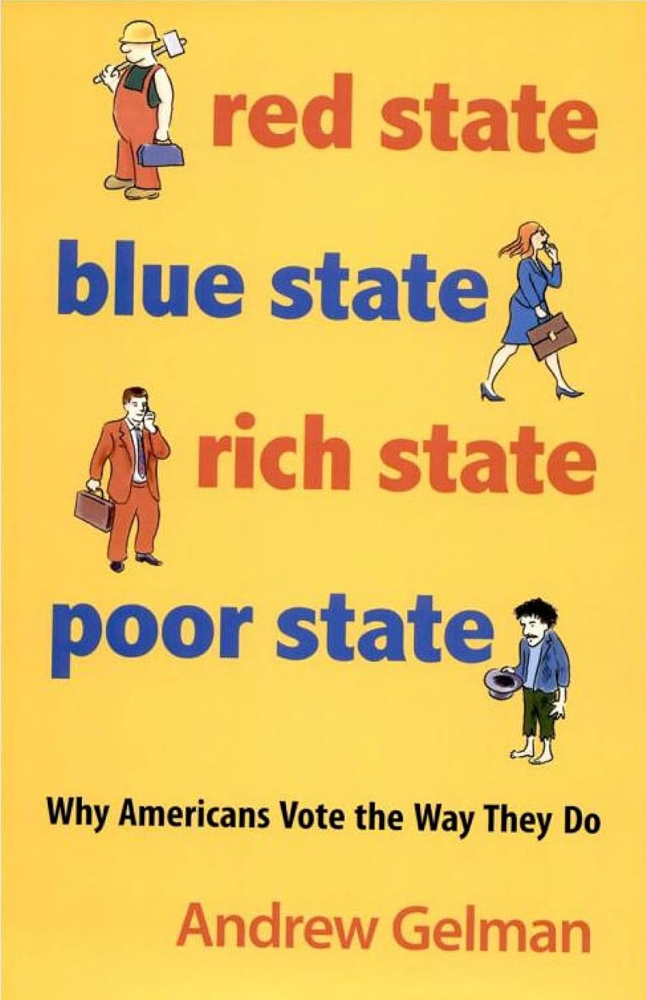{height="600px"}

:::

## Red State Blue State

Facts about US politics (*c.* 2008): 

::: {.incremental}

1. Rich **people** vote Republican at **higher** rates
2. Rich **states** vote Republican at **lower** rates
3. Rich **states** are rich because they have richer people

:::

. . . 

How can we reconcile this? 

## Red State Blue State {.scrollable}


Figure from Gelman *et al*, *Q.J.Poli.Sci.* 2007. 

::: {.center}

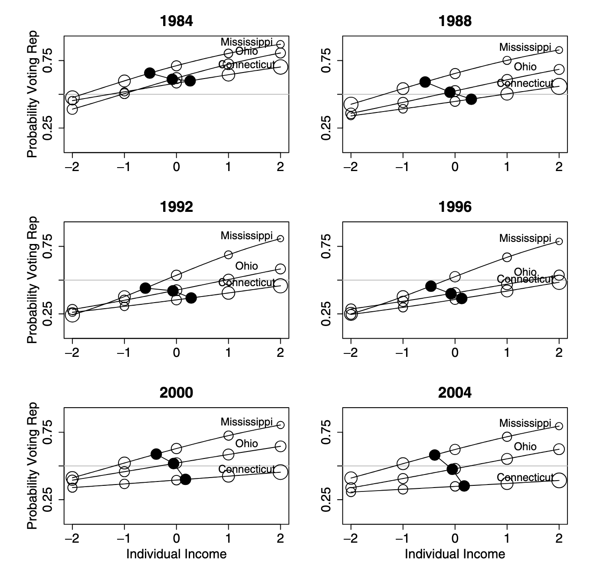{height="200px"}

:::


. . . 

For more, see [this
presentation](https://sites.stat.columbia.edu/gelman/presentations/redbluetalkubc.pdf).

## Additional Resources

Textbook: *[R for Data Science, Part II: Visualize](https://r4ds.hadley.nz/visualize.html)*

. . . 

More on data visualization:

-   C. Wilke. [*Fundamentals of Data Visualization*](https://clauswilke.com/dataviz/)
-   K. Healy. [*Data Visualization*](https://socviz.co/)
-   H. Wickham [*`ggplot2`: Elegant Visualizations for Data Analysis*](https://ggplot2-book.org/)

. . .

General advice on data science projects:

-   B. Yu and R. Barter [*Veridical Data Science*](https://vdsbook.com/)


# Course Administration


# Plotting FAQs

## ggplot2 vs Tableau

-   Tableau
    -   \$\$\$
    -   IT department automatically integrates with data sources
    -   Easy, if it does what you want
-   `ggplot2`
    -   Free
    -   Can use arbitrary data sources, with effort
    -   Flexible / customizable

## ggplot2 vs matplotlib

-   `ggplot2`
    -   *Data* visualizations
    -   Enforces "good practice" via `gg`
-   `matplotlib`
    -   *Scientific* visualizations
    -   More flexible for good or for ill
    -   Inspired by `Matlab` plotting

Closest Python analogue to `ggplot2` is `seaborn`

## Why use + instead of |>

-   `ggplot2` is older than `|>`
-   Per H. Wickham: if `ggplot3` ever gets made, will use `|>`
-   Unlikely to change: too much code depends on it

## Performance

> I tried an interactive plot with $n=132,000$ points, but it brought my computer to a halt. *\[Ed. Paraphrased\]*

That's a lot of plots!!

`ggplot2` is itself pretty fast, but it depends on 
(possibly slow) graphics backends

- Different file types implement graphics differently.
- You should also think about overplotting / pre-processing

We'll talk more about interactivity next week

## Overplotting

Large data sets can lead to _overplotting_:

  - Points "on top of" each other
  - Can also occur with "designed" experiments / rounded data
  
Ways to address: 

- `geom_jitter`
- `geom_hex`
  
## Overplotting {.scrollable}

Jitter: add a bit of random noise so points don't step on each other

```{r}
#| echo: true
#| warning: false
#| fig-height: 4
#| fig-width: 7
library(ggplot2); library(patchwork)
p <- ggplot(mpg, aes(cyl, hwy))
p1 <- p + geom_point() + ggtitle("geom_point")
p2 <- p + geom_jitter() + ggtitle("geom_jitter")
p1 + p2 # Patchwork lets us "add" plots
```

## Hexagonal Binning {.scrollable}

Little "heatmaps" of counts. Hexagons to avoid weird rounding artifacts

```{r}
#| echo: true
#| fig-height: 4
#| fig-width: 7
library(ggplot2); library(patchwork)
p <- ggplot(diamonds, aes(carat, price))
p1 <- p + geom_point() + ggtitle("geom_point")
p2 <- p + geom_hex() + ggtitle("geom_hex")
p1 + p2 # Patchwork lets us 'add' plots
```


## Inside vs. Outside aes()

`aes` maps *data to values*. Outside of `aes`, set constant value

```{r}
#| echo: true
#| fig-height: 4
library(ggplot2)
ggplot(penguins_ok, 
       aes(x=bill_len, y=bill_dep, color=species)) +
    geom_point()
```

## Inside vs. Outside aes()

`aes` maps *data to values*. Outside of `aes`, set constant value

```{r}
#| echo: true
#| fig-height: 4
library(ggplot2)
ggplot(penguins_ok, 
       aes(x=bill_len, y=bill_dep))+ geom_point(color="blue")
```

## Global vs geom_ specific aes()

-   Elements set in `ggplot()` apply to entire plot
-   Elements set in specific `geom` apply there only
    -   Override globals

```{r}
#| echo: true
#| fig-height: 4
#| message: false
library(ggplot2)
ggplot(penguins_ok, 
       aes(x=bill_len, y=bill_dep, color=species))+
    stat_smooth() + geom_point()
```

## Global vs geom_ specific aes()

-   Elements set in `ggplot()` apply to entire plot
-   Elements set in specific `geom` apply there only
    -   Override globals

```{r}
#| echo: true
#| fig-height: 4
#| message: false
library(ggplot2)
ggplot(penguins_ok, 
       aes(x=bill_len, y=bill_dep)) +
    stat_smooth() + geom_point(aes(color=species))
```

## How to Select geoms

Two "modes"

- Exploratory data analysis: Quick, rapid iteration, for your eyes only
  - Let the data tell you a story
  - Low pre-processing: scatter plots, lines, histograms
  
. . . 

- "Publication quality": Polished, for someone else
  - You tell the reader a story
  - More processing, more modeling: trends, line segments, ribbons

## Order of Layers

Order of layers _technically_ matters, but the effect is small

```{r}
#| echo: true
#| fig-height: 4
#| message: false
p1 <- ggplot(penguins_ok, aes(x=bill_len, y=flipper_len)) +
        geom_point(color="black") + 
        stat_smooth(color="blue", method="lm") + ggtitle("Line on points")
p2 <- ggplot(penguins_ok, aes(x=bill_len, y=flipper_len)) +
        stat_smooth(color="blue", method="lm") + 
        geom_point(color="black") + ggtitle("Points on line")
p1 + p2
```

## Order of Layers

Order matters more with theme. Adding a `theme_*()` will override any
`theme()` customization you did: 

```{r}
#| echo: true
#| fig-height: 4
#| message: false
p1 <- p1 + theme_bw() + theme(legend.position="bottom")
p2 <- p2 + theme(legend.position="bottom") + theme_bw() 
p1 + p2
```

## stat_poly_line vs stat_smooth

By default `stat_smooth` fits a _generalized additive model_ (GAM)

`ggpmisc::stat_poly_line` and `stat_poly_eq` fit linear models, so 
they can expose more machinery. 

. . . 

What is a GAM?

- Take 9890 with me (typically Spring semester) to find out!
- Free Course: ["GAMs in R"](https://noamross.github.io/gams-in-r-course/)
  from Noam Ross

## Titles and Captions

```{r}
#| echo: true
ggplot() + 
    labs(title="Title", subtitle="Subtitle", caption="Caption",
         tag="Tag", alt="Alt-Text", alt_insight="Alt-Insight")
```

`+ggtitle("text")` is just shorthand for `+labs(title="text")`

## Importance of Aesthetics

Perceptually: 

- Location > Color > Size > Shape

Humans are better at: 

- Length > Area > Volume

## When to Facet?

Facets are `group_by` for plots. Useful for

- Distinguishing intra- vs inter-group trends
- Avoiding overplotting


## Twin Axes Plots

> How can I implement a dual (twin) axis plot in `ggplot2`?

Disfavored. But if you must ...

> [`sec.axis`](https://r-graph-gallery.com/line-chart-dual-Y-axis-ggplot2.html)

Doesn't allow *arbitrary* secondary axes; allows *transformed* axes 
(e.g., Celsius and Fahrenheit)


## Embedding Images {.scrollable}

See the `ggimage` or `ggflags` package for images as "points":

```{r}
#| echo: true
if(!require("ggflags", quiet=TRUE)){
    devtools::install_github("jimjam-slam/ggflags"); 
}
library(ggflags)
d <- data.frame(x=rnorm(50), y=rnorm(50), 
                country=sample(c("ar","fr", "nz", "gb", "es", "ca"), 50, TRUE), 
                stringsAsFactors = FALSE)
ggplot(d, aes(x=x, y=y, country=country, size=x)) + 
  geom_flag() + scale_country()
```

## Embedding Images {.scrollable}

See `cowplot::draw_image()` for image background: 

```{r}
#| echo: true
#| message: false
library(cowplot)
p <- ggplot(iris, aes(x = Sepal.Length, fill = Species)) +
  geom_density(alpha = 0.7) +
  scale_y_continuous(expand = expansion(mult = c(0, 0.05))) +
  theme_half_open(12)

logo_file <- system.file("extdata", "logo.png", package = "cowplot")
ggdraw() +
  draw_image(
    logo_file, scale = .7
  ) +
  draw_plot(p)
```


# Wrap-Up

## Review

`ggplot2`: 

- Structured graphics for _statistical visualization_
- Grammar of Graphics for structured plotting
  - `geom`, `stat`, `scale`, `aes`, *etc.*
- Integrates with `dplyr`, `tidyr` to get into suitable format

## Orientation

- Communicating Results (`quarto`)  ✅
- `R` Basics  ✅
- Data Manipulation in `R`  ✅
- Data Visualization in `R`  ⬅️
  - Static Plots  ⬅️
  - Interactivity, Maps, Animated Plots
- Getting Data into `R`
- Statistical Modeling in `R`


## Next Time


::: {.small}

- Team Formation  ✅
- Team Contracts  ✅
- Proposal Presentations ✅
- Mid-Semester Check-Ins ⬅️
- Mid-Semester Peer Evaluations
- Final Presentations
- Final Reports
- Final Peer Evaluations

:::

No Pre-Assignment.


